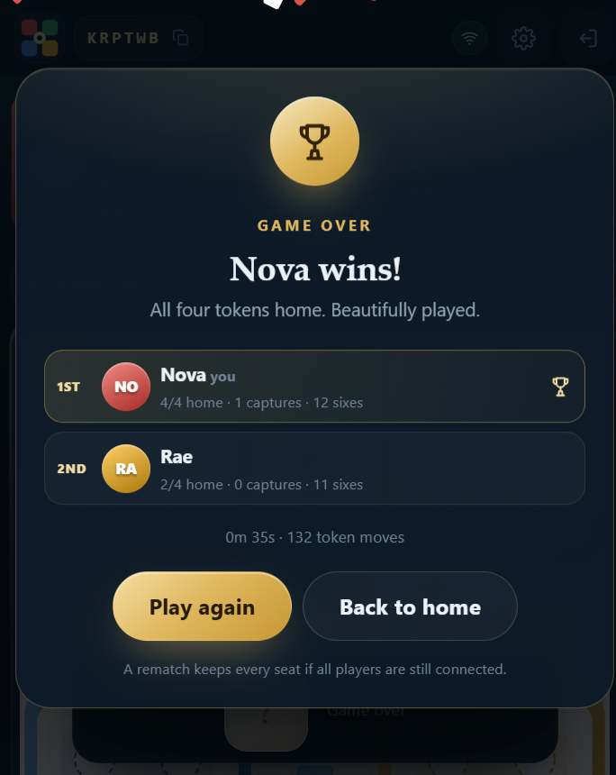

# Ludo ANSARY

A complete, server-authoritative online Ludo game for the browser. Private
rooms, invite links, classic rules, reconnection, and a fully responsive
mobile-first interface — built to run on a single free Node.js service with no
database and no paid APIs.



## What is included

- **Private rooms for 2, 3, or 4 players** with a six-character code and a
  shareable link at `/room/CODE`.
- **Server-authoritative rules.** Dice rolls, legal moves, captures, home
  columns, turn order, and the winner are validated by the server, never by the
  browser.
- **Classic Ludo board and rules.** Four tokens per player, roll a 6 to leave
  base, 52-cell ring, five-cell home column, exact roll to finish, captures on
  unsafe squares, and first player to bring all four tokens home wins.
- **Configurable variants.** Extra turn on a 6, on a capture, or on finishing a
  token; optional three-sixes forfeit; optional capture on safe squares.
- **Seat-safe reconnection.** A private seat secret is stored in the browser, so
  a refresh, tab close, or short network drop puts the player back in the same
  seat instead of taking a new one.
- **Room life support.** Disconnected players are auto-played after a grace
  period, turns with no legal move pass automatically, idle hosts transfer after
  60 seconds, and stale rooms are cleaned up.
- **Complete game flow.** Landing page, create/join, lobby with ready states,
  live game, event log, winner overlay with rankings, and host-controlled
  rematch.
- **Premium presentation.** Original vector artwork, animated token movement,
  responsive desktop/mobile layouts, reduced-motion support, and sound effects
  and music synthesized in the browser with the Web Audio API (no media files).
- **Zero-cost architecture.** One Node process serves the built React app and
  Socket.IO. In-memory rooms mean no database bill and no external services.

## Tech stack

| Layer    | Technology                                                        |
| -------- | ----------------------------------------------------------------- |
| Client   | React 19, React Router 7, Vite 8, TypeScript                      |
| Server   | Node.js, Express 4, Socket.IO 4, TypeScript                       |
| Shared   | Pure TypeScript rules engine and protocol types                   |
| Tests    | Node's built-in test runner (engine + live Socket.IO integration) |
| Hosting  | Any Node host; Render's free web service is the recommended setup |

No Tailwind, no component library, no database, no paid third-party service.

## Quick start

Requirements: **Node.js 20 or newer** (Node 24 LTS recommended) and npm.

```bash
npm install
npm run dev
```

Open <http://localhost:5173>. The Vite dev server proxies `/api` and
`/socket.io` to the game server on port 4000.

To try multiplayer on one machine, open the room link in a second browser
profile or a private window. To try it on phones on the same network, open
`http://<your-computer-LAN-IP>:5173` on each device.

### Production build locally

```bash
npm run build
npm start
```

The Node server starts on <http://localhost:4000> and serves both the API,
Socket.IO, and the built client. Use `PORT` to change the port.

### Quality checks

```bash
npm run typecheck   # TypeScript, no emit
npm test            # 35 tests: rules engine + socket integration
npm run build       # client bundle + server bundle
```

## How to play

1. Create a room on the home page and choose 2, 3, or 4 players.
2. Share the invite link or the six-character room code.
3. Each guest joins with a display name and marks themselves ready.
4. The host starts the game. Seats and colors are assigned automatically.
5. On your turn, roll the dice, then select a highlighted token to move.
6. A 6 lets a token leave base and normally grants another roll. Capturing and
   finishing a token can also grant another roll, depending on the room rules.
7. The first player to bring all four tokens to the center wins. The result
   screen shows final rankings; the host can start a rematch with the same
   seats.

If a player disconnects, their turns are auto-played after a short grace period
so the game keeps moving. If a reconnecting player returns before their seat is
released, they resume control.

## Rules and variants

The defaults follow the common classic rules:

| Rule                                | Default |
| ----------------------------------- | ------- |
| Roll a 6 to leave base              | On      |
| Extra turn on a 6                   | On      |
| Extra turn on a capture             | On      |
| Extra turn on finishing a token     | On      |
| Three consecutive 6s forfeit turn   | Off     |
| Capture on a safe (star) square     | Off     |
| Exact roll required to finish       | Always  |
| Winner is the first player finished | Always  |

Safe squares are the four colored start squares and the four star squares.
Captures send opponents back to base. The host picks the variants when creating
the room.

## Configuration

The single-service deployment needs **no environment variables**. These are
available for tuning or split deployments:

| Variable               | Default   | Purpose                                                        |
| ---------------------- | --------- | -------------------------------------------------------------- |
| `PORT`                 | `4000`    | HTTP + WebSocket port                                          |
| `NODE_ENV`             | —         | Set to `production` on a host                                  |
| `CLIENT_ORIGINS`       | *(same)*  | Comma-separated allowed origins for a split client/server setup |
| `VITE_SERVER_URL`      | *(same)*  | Build-time server URL for a split client/server setup           |
| `TURN_AUTOPLAY_MS`     | `12000`   | Delay before an absent player's roll is auto-played             |
| `AUTO_MOVE_MS`         | `2600`    | Delay before an absent player's move is auto-played             |
| `PASS_DELAY_MS`        | `1400`    | Delay before a no-move turn passes                              |
| `HOST_TRANSFER_MS`     | `60000`   | Delay before an absent lobby host is replaced                   |
| `LOBBY_SEAT_TTL_MS`    | `120000`  | How long a disconnected lobby seat is held                      |
| `LOBBY_TTL_MS`         | `1800000` | Empty/idle lobby lifetime (30 minutes)                          |
| `GAME_TTL_MS`          | `7200000` | Idle game lifetime once nobody is connected (2 hours)            |
| `MAX_ROOM_AGE_MS`      | `43200000`| Hard room lifetime (12 hours)                                  |
| `CREATE_PER_MINUTE`    | `12`      | Room creations per IP per minute                               |
| `JOIN_PER_MINUTE`      | `60`      | Join attempts per IP per minute                                |

## Project layout

```text
client/                 React application
  src/pages/            Home, create, join, room route
  src/views/            Lobby, game, result overlays
  src/components/       Board, tokens, dice, dialogs, icons
  src/lib/              Socket client, room session, storage, audio
  src/styles/           Design tokens and responsive CSS
server/                 Express + Socket.IO server
  src/app.ts            Server factory, static client serving, API
  src/hub.ts            Authoritative rooms, timers, snapshots
  src/index.ts          Process entry point / environment config
shared/                 Code shared by client, server, and tests
  src/board.ts          15x15 board geometry and 52-cell ring
  src/engine.ts         Pure rules engine
  src/protocol.ts       Socket.IO event and payload types
tests/                  Engine and socket integration tests
scripts/                Dev runner and production server bundler
render.yaml             Free Render blueprint
Dockerfile              Optional container deployment
DEPLOYMENT.md           Step-by-step zero-cost deployment guide
```

## Design notes

- The client never rolls or moves on its own authority. It sends an intent and
  renders the authoritative snapshot returned by the server.
- Room state is intentionally in memory. That keeps the app free and simple,
  but rooms do not survive a server restart or a free-host spin-down. There is
  no account system or long-term history.
- Each room code is random, unlisted, and only shared through the invite link.
  Rejoining requires the private seat secret stored in the player's browser.
- Rate limits are per process: 120 socket actions per 10 seconds, plus separate
  room-create and join limits per IP.

## Deployment

The recommended zero-cost setup is a single Render Free web service. Render
serves the Node app and supports WebSockets on the free plan. The full walkthrough,
free-tier limits, and alternatives are in [DEPLOYMENT.md](DEPLOYMENT.md).

Quick version:

1. Push this folder to a GitHub repository.
2. In Render, choose **New → Blueprint**, select the repository, and apply the
   included `render.yaml`.
3. Open the generated `https://<service>.onrender.com` URL and create a room.

A `Dockerfile` is included for hosts that prefer containers.

## Known limits

- Free hosts may sleep after inactivity; the first visit can take about a
  minute to wake the service.
- Restarting or redeploying the server clears every room.
- One server instance only. Horizontal scaling would require shared room state
  (for example Redis), which is outside the zero-cost design.
- There are no accounts, friend lists, rankings, or persistent statistics.
